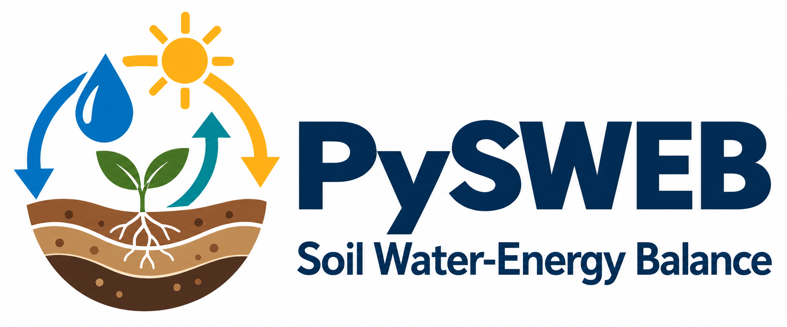

<p align="center"></p>

# PySWEB · Soil Water-Energy Balance

[](https://github.com/yuyi13/PySWEB/actions/workflows/tests.yml)
[](https://www.python.org/)
[](LICENSE)

PySWEB estimates daily, layered soil moisture from precipitation, evapotranspiration and soil hydraulic properties. It links satellite-based SSEBop evapotranspiration with a one-dimensional soil water balance, including root uptake, vertical redistribution and bottom drainage. It continues development of the Sydney Soil Water-Energy Balance model.

**Research software under active development.** The offline example is runnable immediately. Regional applications require external data, appropriate calibration and independent validation. The energy connection enters through the evapotranspiration estimate; the soil solver does not integrate a prognostic soil heat balance.

[Quick start](#quick-start) · [Workflow](#configured-workflow) · [Your soil data](#using-your-own-soil-data) · [Methods](docs/methods.md) · [Migration](docs/migration.md)

## Quick start

Python 3.12 or newer is required. From the repository root:

```bash
git clone https://github.com/yuyi13/PySWEB.git
cd PySWEB
python -m pip install -e ".[dev]"
pysweb demo
```

The demo generates a small synthetic two-layer soil dataset and a full month of forcing, preprocesses a 14-day window, runs four cells and checks water-budget closure. It needs no Earth Engine account or external downloads. Its output is:

```text
examples/outputs/demo/
├── source/       # Synthetic forcing and custom hydraulic properties
├── prepared/     # Aligned daily forcing, soil files and provenance
└── results/      # SWEB_RZSM_2024-01-01_2024-01-14.nc and manifest
```

The same runnable example is available through Python:

```python
from pysweb.demo import run_demo
output = run_demo("examples/outputs/demo")
```

For runtime dependencies only, install `python -m pip install .`. Plotting is available with `python -m pip install ".[plot]"`. Installation currently uses the Git repository; no PyPI publication is claimed.

## Configured workflow

[examples/workflow.toml](examples/workflow.toml) centralizes paths, dates, location, soil source, calibration and model settings. Copy it to a study configuration and edit the values. Relative paths resolve from the configuration file's directory. Set `run.center = [longitude, latitude]` for a default 5.1 km square, selected as exactly 170 × 170 native 30 m pixels. The example location is illustrative. Explicit geographic `run.extent` and projected AOIs remain available for custom areas.

```bash
pysweb workflow --config examples/workflow.toml --dry-run
# After setting a real study location and Earth Engine project:
pysweb workflow --config study.toml
```

The five stages share one implementation in `pysweb.workflow`:

| Stage | Role | Inputs / requirements |
|---|---|---|
| `prepare` | Download Landsat, ERA5-Land, NASADEM and WorldCover; stack meteorology | Earth Engine authentication and your project |
| `ssebop` | Estimate daily ET with land-cover-aware FANO and partition E_s/E_t | Prepared satellite, meteorology, DEM and WorldCover files |
| `preprocess` | Align forcing and soil properties; calculate effective rain | Full calendar-month rain; local or online soil inputs |
| `calibrate` | Fit two domain parameters to reference surface soil moisture | Enabled explicitly; local reference or configured Earth Engine asset |
| `run` | Simulate independent soil columns | Prepared forcing and hydraulic properties |

Select stages with `--stages preprocess,calibrate,run`. The default workflow preserves source download grids, fits on native GSSM cells, and writes both final products on one selected Landsat 30 m UTM grid. It runs only Landsat 8/9 by default, for dates from 2013 onwards. Earlier missions require explicit `run.sensors = ["LT05", "LE07", "LC08", "LC09"]`; no second sensor pathway is launched automatically. For an 8/9 run beginning in 2013, calibration starts on 2014-01-01 by default, reserving the available 2013 record for initialisation. Set `calibration.start` to override this choice. For both calibration and normal runs, the SWB makes one conservative update per day, starts at physical field capacity and carries the available 2013 warm-up state into 2014. Resolved plans and final products identify the warm-up; NetCDF `is_warmup` flags those dates. Repeated spin-up is disabled by default; set `[spinup] enabled = true` to enable it, or `enabled = false` to retain the settings without repetition. Verify forcing coverage; this initialization assumes field capacity rather than claiming complete independence from the starting profile. Calibration is skipped when `calibration.enabled = false`. Its scoring window lies within the continuous simulation window. Set `run.holdout_start` to protect an independent test period. See [native grids and output contracts](docs/native-grids.md). Optional [configured acceptance protocols](docs/configured-protocols.md) integrate validated L7 donors, development-only spin-up, paired support, benchmark timing and site-specific evaluation. See [the workflow guide](docs/workflows.md) for offline operation, HPC execution and individual APIs.

For repeated multi-year initialization, see [calendar-block spin-up](docs/multiyear-spinup.md). A complete 2014–2015 block can be repeated five or ten times without expanding forcing grids or spatial output calendars. Repetition counts include the retained source block; scoring starts afterward. Convergence is checked separately from numerical conservation.

Every configured run writes `resolved-config.json`. Model output manifests record input SHA-256 checksums, configuration, code identity and output checksums. `skip_existing` validates the model output against this identity before reuse. Unmanifested older outputs require regeneration. Generated data and environments stay outside version control.

Default Landsat preparation retains QA and applies pixel cloud masking. SSEBop requires `QA_PIXEL` and `QA_RADSAT`; independently masked legacy files need the explicit `landsat_qa = "pre_masked"` option. See [Landsat quality and pilot reuse](docs/landsat-quality.md) for the mask, zero-valued flags and migration contract.

## Using your own soil data

**Local soil data are a maintained pathway.** `spec/` provides compatibility entrypoints and guidance for the MLConstraints and custom-soil workflows; their implementations live in `pysweb.soil` and use the shared SWB solver.

| Soil source | Status | Contract |
|---|---|---|
| `openlandmap` | Implemented; online | Versioned global clay, sand and organic-carbon assets; five model layers |
| `custom` | Implemented; offline | NetCDF hydraulic properties with units, CRS and explicit layer depths |
| `mlcons` | Implemented; local data required | Existing MLConstraints Clay/Sand/OC rasters, or RDS extraction using R |
| `slga` | Reserved | Fails explicitly until a backend is implemented |

A custom hydraulic file contains `porosity`, `wilting_point`, `available_water_capacity`, `b_coefficient` and `conductivity_sat` on a common layered grid. Supply your actual layer bottoms in millimetres. The model validates units, geometry, CRS and hydraulic ranges before use. See [the soil input contract](docs/soil-inputs.md), [spec/README.md](spec/README.md) and [examples/custom-soil.toml](examples/custom-soil.toml).

Measured hydraulic parameters can avoid uncertainty from global texture maps and pedotransfer functions. Their benefit still depends on measurement quality, depth support and spatial representativeness.

## Outputs and scientific interpretation

Configured native runs produce `products/SSEBop_ET.nc` and `products/SWEB_RZSM.nc` with identical CRS, affine transform, dimensions and x/y coordinates. The first contains ET, its components and used auxiliaries. The second contains `rzsm_default(time, layer, y, x)` and, when calibration is enabled, `rzsm_calibrated`, together with shared forcing, hydraulics and scenario-specific budgets/final states. Individual `swb-run` calls retain their `rzsm_layer_*` layout. See [the output layout](docs/output-netcdf-layout.md). The default `state_timing = "start"` preserves historical timestamps. Select `"end"` to report each day's updated state. The final state is retained in both modes.

Water-budget diagnostics distinguish infiltration, actual soil-limited ET, drainage, saturation overflow, numerical storage adjustments and residuals. Missing forcing freezes a cell's state and marks that day invalid; these stored states must be screened with the QC variable. Calibration excludes cells with incomplete forcing and fits area-weighted GSSM cell–day residuals. Four scalar parameters are fitted per configured site/domain and transferred to the fine-grid simulation; they are not parameter rasters. A failed solver candidate receives an infinite objective.

Effective rainfall follows the existing monthly Smith formula, evaluated using complete calendar months before slicing the requested window. Partial-month source data now fail explicitly. These changes can alter historical outputs; [migration notes](docs/migration.md) identify the intentional differences.

This update verifies numerical and software behavior with synthetic tests. It does not establish regional predictive skill. Retained empirical assumptions, reference-data limitations, initialization and validation priorities are documented in [methods and limitations](docs/methods.md).

## Repository map

| Path | Purpose |
|---|---|
| [pysweb/](pysweb/) | Canonical package: `ssebop`, `swb`, `soil`, `met`, `dem`, `io`, `visualisation` |
| [workflows/](workflows/) | Thin numbered CLIs and portable shell launchers |
| [spec/](spec/) | Maintained custom-soil / MLConstraints compatibility entrypoints |
| [examples/](examples/) | Small configurations; ignored generated demo results |
| [notebooks/](notebooks/README.md) | Shared-config run notebook and diagnostic plotting examples |
| [tests/](tests/) | Unit, scientific-contract and integration tests |
| [docs/](docs/) | Methods, data contracts, workflow and migration guidance |
| [.github/workflows/](.github/workflows/) | Linux/macOS tests, wheel build and installed-package demo |

`pysweb/` is the sole runtime package. The former top-level `core/` retirement is complete; no new code should depend on that namespace. Obsolete `superpowers` implementation plans have been replaced by maintained documentation, with historical versions retained in Git.

Notebook entrypoints are [01_run_pysweb.ipynb](notebooks/01_run_pysweb.ipynb), [02_plot_heatmap.ipynb](notebooks/02_plot_heatmap.ipynb) and [03_plot_time_series.ipynb](notebooks/03_plot_time_series.ipynb). Plotting is owned by `pysweb.visualisation`; `workflows/6_plot_results.py` remains available.

## Data and citation

The full workflow uses external datasets with their own access and reuse terms: [Landsat Collection 2](https://developers.google.com/earth-engine/datasets/catalog/LANDSAT_LC08_C02_T1_L2), [ERA5-Land daily aggregates](https://developers.google.com/earth-engine/datasets/catalog/ECMWF_ERA5_LAND_DAILY_AGGR), [NASADEM](https://developers.google.com/earth-engine/datasets/catalog/NASA_NASADEM_HGT_001) and [OpenLandMap](https://openlandmap.org/). The default reference SSM asset is user-hosted and may require access permission. [Data provenance](docs/data.md) lists versions, units and acquisition constraints.

Cite the software version and commit used in an analysis; GitHub can export the [CITATION.cff](CITATION.cff) metadata. No paper DOI or permanent software archive is currently assigned in this repository.

```text
Yu, Y. (2026). PySWEB: Soil Water-Energy Balance (version 0.1.0).
https://github.com/yuyi13/PySWEB [include the commit used].
```

The code is distributed under the [MIT licence](LICENSE). Dataset licences remain those of their providers. For development checks and contribution guidance, see [CONTRIBUTING.md](CONTRIBUTING.md) and [CHANGELOG.md](CHANGELOG.md).

Component outputs use `E_s` (soil evaporation), `E_t` (transpiration) and `f_t` (transpiration fraction). See the [notation migration and legacy-input policy](docs/migration.md#component-notation-migration-11-october-2026).

The [conservative two-parameter SWB formulation](docs/swb-formulation.md) calibrates diffusivity and root beta, uses fixed versioned GSSM references and records separate actual/unmet E/T with conservative water budgets. V3 applies the GSSM/WP dry ratio to extraction thresholds in 0–15 cm, a half adjustment in 15–30 cm, and hydraulic WP below 30 cm. Continuous three-day relaxation and physical zero-to-porosity bounds are retained. Existing v2 and four-parameter calibrations require recalibration; immutable GSSM reference artifacts remain compatible.
