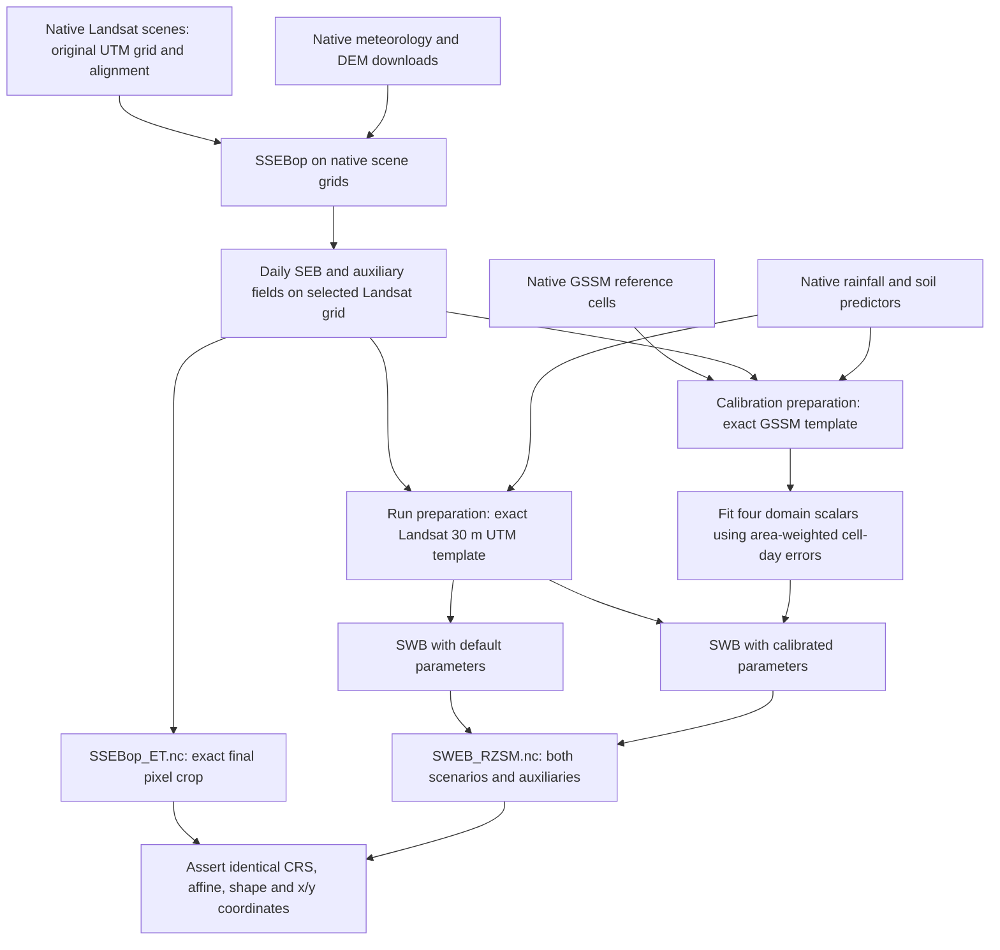

# Native downloads, two preparation grids, one final grid

The configured workflow defaults to `run.grid_mode = "native"`. `run.extent` remains a geographic bounding box used to select complete pixels. It does not prescribe an output projection or degree resolution.



## Acquisition and source metadata

Downloads specify the selected source band's **CRS and full affine transform**, not a nominal `scale`. An explicit integer-pixel window translates the origin by whole pixels and provides exact dimensions; this avoids ambiguous clipping from a global source origin. Every band in a multiband export must share that source grid; incompatible bands fail explicitly. A downloaded chip or tile mosaic must be an integer-pixel subset of that grid. The downloader records the source projection and verifies the resulting CRS, pixel size, rotation and offset. The Landsat/ERA5 downloader reuses files only with matching manifests and checksums. Source product grids are preserved: a Landsat Level-2 30 m thermal product does not become an independent 30 m thermal observation.

Landsat 8/9 (`LC08`, `LC09`) are the defaults. Set `run.sensors = ["LT05", "LE07", "LC08", "LC09"]` to include earlier missions. Only Level-2 scenes with surface-temperature processing (`L2SP`) are requested. QA is retained; Landsat 7 SLC gaps remain missing unless an explicit, independently checked gap-fill preparation is supplied. No automatic cross-sensor adjustment is introduced.

The generic downloader chooses the first source image for a date; median composites must be prepared after acquisition because they do not have one unambiguous native grid. Separate sensor exports are retained. SSEBop selects one retrieval per date in deterministic order LC09, LC08, LE07, LT05, then path. The selected paths are recorded in the SEB output. Multiple UTM source grids are retained in raw downloads; derived scene fields are explicitly aligned onto the first selected scene's processing grid.

Native OpenLandMap predictors are cached under `inputs/soil_native/`; native GSSM values are retained in `inputs/reference_ssm_native.nc`. GSSM tiles and annual stacks must have congruent source grids before being combined. Full source-file identities accompany prepared outputs. All auxiliary fields in the final files have been aligned to the final grid; their original source metadata remains in the native inputs/manifests.

DEM acquisition covers the complete exported ERA5 pixel footprints. Reference-ET preparation averages elevation onto native ERA5 cells and rejects an undersized DEM; missing elevation support remains missing.

This follows Earth Engine's [export alignment guidance](https://developers.google.com/earth-engine/guides/exporting_images#setting-scale): resolution alone does not preserve the original pixel origin.

## Two preparation targets

**Calibration:** select every complete native GSSM cell intersecting the requested chip. Inputs cover those entire footprints, including portions outside the chip. Continuous fields use area-overlap averaging; missing source support remains missing. GSSM observations are exact subsets, without interpolation. A nominal 5 km × 5 km chip contains roughly a few dozen 1 km cells; counts depend on latitude and alignment.

**Simulation:** select complete pixels from the chosen native Landsat UTM scene. The exact 30 m grid is shared by SEB and SWB products. Meteorology and soil are explicitly interpolated to this grid. The processing extent is padded by `processing_buffer_m` (default 6000 m) for FANO and whole GSSM footprints, then the final SEB file is cropped without resampling. Increase the buffer if spatial FANO scales require it. Native UTM grids avoid degree-based pixel dimensions; source coverage limitations still apply.

The code rejects a source template that is not a 30 m UTM grid. This deliberate validation also rejects earlier geographic Landsat downloads. Reacquire those inputs into a new run directory; changing only the CRS label cannot correct them.

## Calibration and independent periods

For valid cell-day pairs `(i,t)`, the objective is:

```text
RMSE = sqrt(sum(area_i * (simulation_it - GSSM_it)^2)
            / sum(area_i))
```

The denominator includes an area's contribution once per valid day. Errors in different cells cannot cancel before squaring. Each configured domain produces one CSV row containing `diff_factor`, `sm_max_factor`, `sm_min_factor`, `root_beta`, the objective and observation count. These four fitted values are scalars, shared across the site's soil columns.

`run.start` begins continuous simulation and initialization. `calibration.start/end` select scoring dates inside that interval. Earlier simulated days are excluded from the objective, as are at least `calibration.spinup_days` initial days. For a 2011–2020 fit with independent 2021–2025 testing, include the desired initialization interval in `run.start`, set calibration end to `2020-12-31`, and set `run.holdout_start = "2021-01-01"`. Do not use test-period performance to revise these settings.

With calibration enabled, the dT climatology ends no later than calibration end. Smoothing/interpolation never crosses that boundary, and an optional fixed NDVI root-depth cap uses development dates only. These restrictions prevent later observations from reconstructing earlier calibration forcing. Inputs must cover the needed climatology days of year. Missing scene edges and overlong temporal gaps remain missing: the workflow does not silently extrapolate ET or turn missing inputs into zeros. Check forcing coverage before launching a long calibration; cells with incomplete calibration forcing are excluded.

`calibration-transfer.json` reports development-only fine-to-GSSM diagnostics using complete final-output footprints and common valid pairs. Edge cells outside the final chip are excluded, so its population can differ from the coarse fit. A chip smaller than a GSSM footprint can legitimately have no transfer score. This diagnostic never changes the fitted parameters.

## Products, execution and compatibility

See [output variables](output-netcdf-layout.md). The final product grid check writes `products/grid-contract.json` and rejects unequal spatial grids. With calibration disabled, the SWB file contains only the default scenario; a calibrated result is never fabricated.

Use `--stages prepare,ssebop`, then `--stages preprocess,calibrate,run`, or run all stages. Resuming later stages uses the same resolved paths. Both SWB scenarios are simulated from the same dates and initialization convention, with common forcing and soil; calibration changes only the four scalar values.

The coarse calibration grid reduces solver work but does not remove the cost of native-scene SSEBop and fine-grid simulation. These stages still allocate in-memory arrays; size HPC memory for the padded extent, record length, layers and workers. Consolidation and final cropping copy time slabs to avoid an additional full result cube. GPU execution is not introduced by this change.

Older TOML files containing `run.resolution` select the explicit legacy geographic workflow, retaining the daily-domain-mean calibration objective unless overridden. Use `grid_mode = "legacy"` when maintaining such a study. The native workflow rejects degree-resolution overrides. Individual component APIs remain available, including legacy single-scenario outputs and `--objective domain_mean` for deliberate reproduction; the standalone calibration CLI now defaults to `cell`. Use a new directory when changing grids or the objective; existing calibrated parameters do not represent the new fit.
